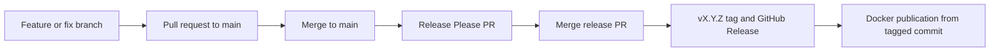

`main` is the Release Please target and the authoritative release line. Feature and fix branches
open pull requests against `main`. Conventional Commit titles determine generated release notes and
semantic-version bumps.

Release Please is the only process allowed to create version commits, update `CHANGELOG.md`, create
release tags, or create GitHub Releases. Legacy per-version release branches, release-freeze issues,
manual version-bump flows, and parallel-cycle synchronization are not part of the active model.

Related documents:

- [CONTRIBUTING.md](../../CONTRIBUTING.md)
- [RELEASE_CHECKLIST.md](./RELEASE_CHECKLIST.md)
- [RELEASE_GREEN.md](./RELEASE_GREEN.md)
